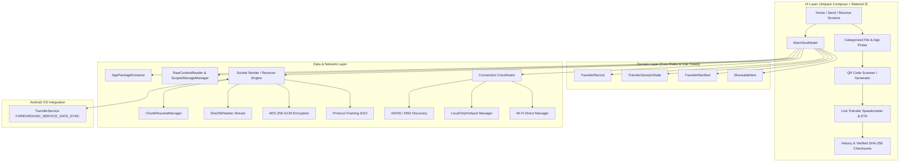

# Shario 🚀
> **Shario — Fast Sharing. Zero Hassle.**
>
> **100% Bit-for-Bit Original Phone-to-Phone File Sharing**

[-brightgreen?style=for-the-badge&logo=android)](https://github.com/abdulraheemasangi/shario/releases/download/v1.0.0/app-release.apk)
[](https://github.com/abdulraheemasangi/shario/releases)
[](https://github.com/abdulraheemasangi/shario/actions)
[](LICENSE)
[]()
[]()

---

### 📲 Download Links
- 📥 **[Direct Download: app-release.apk (Latest v1.0.0)](https://github.com/abdulraheemasangi/shario/releases/download/v1.0.0/app-release.apk)**
- 📦 **[GitHub Releases Page & Version History](https://github.com/abdulraheemasangi/shario/releases)**
- ⚙️ **[Automated CI/CD Build Artifacts](https://github.com/abdulraheemasangi/shario/actions)**

---

Shario is a high-throughput, offline file transfer app for Android engineered to transfer files, photos, 4K videos, lossless audio, documents, and split APK bundles **without compression, without resizing, and without metadata stripping**.

Every received file is mathematically verified using **SHA-256 digests** to guarantee that the destination file is byte-for-byte identical to the source.

---

## 📸 Screenshots & UI Preview

```
+--------------------------+  +--------------------------+  +--------------------------+
|          Shario          |  |      Select Files        |  |     Active Transfer      |
| Fast Sharing.Zero Hassle.|  | Photos  Videos  Apps ... |  | Pixel 9 Pro -> Galaxy S24|
|                          |  |                          |  |                          |
|  [ Bit-for-Bit Shield ]  |  | [✓] IMG_48MP_RAW.dng     |  | 42.80 MB/s    ETA: 00:35 |
|  No re-encoding • EXIF   |  |     48.2 MB • Adobe RAW  |  | [=================>    ] |
|                          |  |                          |  |                          |
|  +-------+    +-------+  |  | [✓] VID_4K_60FPS.mp4     |  | IMG_48MP.dng [Verified✓]|
|  | SEND  |    |RECEIVE|  |  |     1.42 GB • 4K UHD     |  | VID_4K.mp4   [Chunk 12]  |
|  +-------+    +-------+  |  |                          |  |                          |
|                          |  | Send (2 Items • 1.47 GB) |  | [  Pause  ]  [ Cancel ]  |
+--------------------------+  +--------------------------+  +--------------------------+
```

---

## ⚡ Non-Negotiable Quality Guarantees

1. **Zero Compression**: Images and videos are NEVER downsampled, resized, re-compressed into WebP/JPEG, or transcoded.
2. **GPS & EXIF Preservation**: Uses Android's `ACCESS_MEDIA_LOCATION` and `MediaStore.setRequireOriginal()` so camera metadata, timestamps, and GPS coordinates remain 100% intact.
3. **Cryptographic Verification**: The sender calculates a streaming SHA-256 hash. The receiver computes the hash while writing chunks and emits a `Verified ✓` confirmation badge only on exact match.
4. **Resumable 10GB+ Streaming**: Files are sliced into 1MB chunks over a non-blocking TCP socket pipeline with custom offset negotiation. Memory usage never exceeds 64KB buffers.
5. **Full Split APK / App Bundle Support**: Extracts not just `base.apk` but all configuration splits (`split-arm64_v8a.apk`, `split-xxhdpi.apk`) into an installable package container.

---

## 🏗 Architecture Overview

Shario is built according to **Clean Architecture** and **MVVM** principles using Kotlin Coroutines, Flow, Jetpack Compose, and Dagger Hilt.



---

## 📡 Custom Wire Protocol Specification

Shario transfers data over a streamlined, low-overhead binary framing protocol over TCP:

```
+------------+-----------+-----------+-------------+--------------+------------------+
| Magic Byte | Type Byte |  File ID  | Chunk Index | Length (Int) |     Payload      |
|  (1 byte)  | (1 byte)  | (4 bytes) |  (4 bytes)  |  (4 bytes)   |  (Length bytes)  |
|    0x53    | 0x01-0x08 | Big Endian| Big Endian  |  Big Endian  | Raw / Encrypted  |
+------------+-----------+-----------+-------------+--------------+------------------+
```

### Packet Types
- `0x01` (`TYPE_HANDSHAKE`): Protocol version and device info exchange.
- `0x02` (`TYPE_MANIFEST`): JSON queue manifest with file names, byte lengths, chunk sizes, and expected SHA-256 digests.
- `0x03` (`TYPE_RESUME_REQUEST`): Queries receiver for existing partial `.part` file size.
- `0x04` (`TYPE_RESUME_RESPONSE`): Receiver returns aligned byte offset and starting chunk index.
- `0x05` (`TYPE_CHUNK_DATA`): 1MB raw or AES-256-GCM authenticated payload.
- `0x06` (`TYPE_FILE_COMPLETE`): Notifies receiver that all bytes for the file ID have been sent.
- `0x07` (`TYPE_VERIFICATION_ACK`): Receiver replies with `{"status": "VERIFIED" | "MISMATCH", "actualHash": "..."}`.
- `0x08` (`TYPE_CANCEL`): Aborts the active transfer session.

---

## 🔒 End-to-End Encryption

- **Algorithm**: `AES-256-GCM` (Galois/Counter Mode with 128-bit authentication tag).
- **Key Exchange**: Out-of-band via QR code pairing. The receiver creates an ephemeral 256-bit symmetric key, embeds it in the QR code payload, and the sender imports it upon scanning.
- **Tamper Protection**: Any modified, corrupted, or injected byte causes an immediate `AEADBadTagException` and auto-retry of the corrupt chunk.

---

## 📁 Repository Structure

```text
Shario/
├── .github/workflows/
│   └── build-apk.yml               # Automated CI to build Release APK & run tests
├── app/
│   ├── build.gradle.kts            # App dependencies (Compose, Hilt, CameraX, ZXing)
│   └── src/
│       ├── main/
│       │   ├── AndroidManifest.xml # Android 10-15 Scoped Storage & P2P permissions
│       │   ├── res/
│       │   │   ├── values/strings.xml      # English localization (Shario)
│       │   │   └── values-hi/strings.xml   # Hindi (हिंदी) localization
│       │   └── java/org/zeroshare/app/
│       │       ├── SharioApplication.kt
│       │       ├── core/
│       │       │   ├── constants/ProtocolConstants.kt
│       │       │   ├── hash/Sha256Hasher.kt
│       │       │   ├── security/AesGcmCipher.kt
│       │       │   └── security/QrPayloadCodec.kt
│       │       ├── domain/model/   # ShareableItem, Manifest, Progress
│       │       ├── data/
│       │       │   ├── connection/ # Wi-Fi Direct, Hotspot, NSD
│       │       │   ├── engine/     # Socket engines, ProtocolPacket, Resume
│       │       │   ├── storage/    # ScopedStorage, RawContentReader, Picker
│       │       │   └── appextractor/AppPackageExtractor.kt
│       │       ├── service/        # DATA_SYNC Foreground Service & Notifications
│       │       └── presentation/   # Compose UI (Home, Picker, Discovery, Transfer)
│       └── test/java/org/zeroshare/app/
│           ├── hash/Sha256HasherTest.kt
│           ├── engine/ProtocolFramingTest.kt
│           ├── engine/ChunkResumeTest.kt
│           ├── security/AesGcmCipherTest.kt
│           └── quality/ZeroQualityLossTest.kt
├── test_quality_verification.py    # Cross-platform CLI test suite
├── build.gradle.kts
├── settings.gradle.kts
└── README.md
```

---

## 🛠 Build & Run Instructions

### Prerequisites
- JDK 17
- Android SDK (API Level 35, Build Tools 35.0.0)

### 1. Build from CLI
```bash
# Clone the repository
git clone https://github.com/your-username/Shario.git
cd Shario

# Run Unit Tests
./gradlew test

# Build Debug APK
./gradlew assembleDebug

# Build Release APK
./gradlew assembleRelease
```
The output APK is located at:
`app/build/outputs/apk/release/app-release.apk`

### 2. Standalone Verification Suite (No Android SDK required)
You can verify the protocol framing and run the 48MP photo / 4K video quality test immediately:
```bash
python test_quality_verification.py
```

---

## ⚠️ Platform Nuances & Technical Limitations

1. **Android 10+ Wi-Fi Hotspot Restrictions**: Android prevents apps from silently altering system Wi-Fi hotspot passwords. Shario uses `WifiManager.startLocalOnlyHotspot()` and embeds dynamic credentials directly into the receiver's pairing QR code.
2. **Media Location Redaction**: Starting in Android 10, the OS redacts EXIF GPS coordinates from `content://` URIs by default. Shario requests `ACCESS_MEDIA_LOCATION` and explicitly calls `MediaStore.setRequireOriginal(uri)` before streaming.
3. **Split APK Installation**: Apps downloaded from Google Play contain split APKs. Shario bundles them into `.apks` archives and commits them atomically using `PackageInstaller.Session`. Target devices must grant "Install Unknown Apps" permission.

---

## 🗺 Roadmap

- [x] High-speed Wi-Fi Direct & Local Hotspot sockets
- [x] Scoped Storage zero-loss reader & publisher
- [x] Streaming SHA-256 checksum verification
- [x] Resumable chunked file transfers (10GB+ capability)
- [x] End-to-End AES-256-GCM encryption with QR key exchange
- [x] Installed App & Split APK extractor / installer
- [x] Hindi + English localization
- [ ] WebRTC browser fallback for phone-to-PC transfers
- [ ] Bluetooth LE beaconing for zero-touch ambient pairing

---

## 📄 License

Shario is licensed under the [MIT License](LICENSE).
Built with ❤️ for privacy, quality, and open-source freedom.
